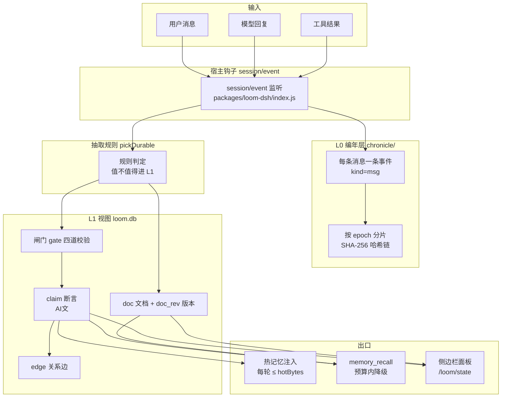
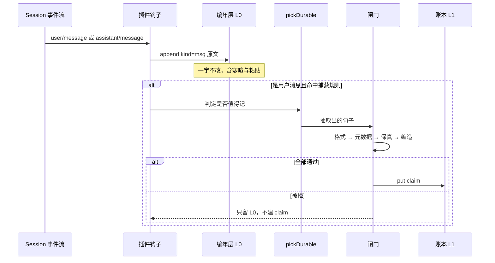
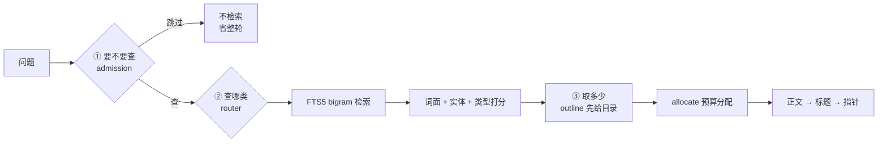

# LOOM 架构

> 这份文档描述**实际实现**，不是设想。每个框都对应仓库里的真实模块。

## 一句话

**原文全收（L0），视图按需压缩（L1），每轮只注入一小块（热记忆）。**

## 1. 分层



**关键点**：L0 与 L1 是**并列**的，不是上下游。压缩失败（闸门拒绝）不影响原文留存。

## 2. 写入路径



## 3. 读取路径



三问各自省一种成本：**省整轮 / 省范围 / 省 token**。

## 4. 模块地图

| 层 | 模块 | 职责 |
| --- | --- | --- |
| 格式 | `aiw.js` | AI文 解析、剥尾、bigram、内容指纹 |
| 写入 | `gate.js` | 四道闸门（格式/元数据/保真/编造） |
| 写入 | `ingest.js` | **唯一**写入口：剥尾 → 建草稿 → 过闸 → 落库 → 追加 L0 |
| 写入 | `constrain.js` | 生成前约束（must_keep 前移） |
| 存储 | `sqlite-ledger.js` | claim / doc / doc_rev / edge / FTS |
| 存储 | `chronicle.js` | epoch 分片、哈希链、AES-256-GCM |
| 读取 | `admission.js` | 要不要查 |
| 读取 | `router.js` | 查哪类（词面 + 实体 + 类型） |
| 读取 | `allocate.js` | 预算分配与降级 |
| 读取 | `recall.js` | 三问合成管道 |
| 输出 | `hot.js` | 每轮注入的热记忆（有界） |
| 输出 | `render.js` | legend / plain / xml 三策略 |
| 生命周期 | `settle.js` | 用到了哪条、对不对 → 改权重 |
| 生命周期 | `decay.js` | 差异化半衰期 + 三档降级 |
| 生命周期 | `transfer.js` / `bundle.js` / `zip.js` | 导出导入（JSON / ZIP） |
| 捕获 | `capture.js` / `autocapture.js` | 显式指令 vs 自动判定 |
| 归档 | `archive.js` | 原文入 L0（去重指纹） |

## 5. 落盘布局

```
~/.dsh/loom/
├── loom.db              SQLite
│   ├── claim            断言（有效 / 失效）
│   ├── claim_fts        bigram 全文索引
│   ├── doc              项目文档
│   ├── doc_rev          文档历史版本
│   ├── doc_fts          文档索引
│   ├── edge             关系边
│   ├── external_ref     外部引用时效
│   └── supersede_log    冲突理由
├── chronicle/
│   ├── meta.json        epoch 表 + 墓碑
│   ├── master.key       主密钥
│   └── epochs/
│       └── ep-YYYYMMDD.jsonl   加密事件流（哈希链）
└── hook-errors.log      钩子异常与捕获记录
```

库路径可配（面板 → 设置 → 库文件路径），`chronicle/` 始终跟着库走。

## 6. 宿主钩子与路由

| 类型 | 名称 | 用途 |
| --- | --- | --- |
| 事件 | `session/event` | 归档 + 自动捕获（**唯一**可信来源） |
| 服务 | `systemPrompt` | 注入热记忆与使用协议 |
| 服务 | `commands` | `/loom` 斜杠命令 |
| 服务 | `webServer` | 8 条 HTTP 路由（面板数据与写操作） |
| 服务 | `configEditor` | 面板改配置 → 持久化到 profile |

**踩过的坑**：`agent/pre-step` 在真实宿主里从未触发，自动捕获挂在那里导致「归档有、记忆空」。现在统一走 `session/event`。

## 7. 不变量

1. **`ingest()` 是唯一写入断言的地方** —— 剥离尾部只发生一次
2. **L0 只追加** —— 修改靠新事件，删除靠销毁密钥
3. **删除 = 加密销毁 + 墓碑** —— 内容不可读，链仍可验
4. **压缩失败不丢原文** —— 闸门拒绝只影响 L1
5. **注入有界** —— 热记忆不超过 `hotBytes`，它进每一轮上下文
